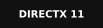

# Hi, I'm 양우정 (UJeong Yang) 👋

**엔진 밑단부터 게임플레이까지 만드는 게임 클라이언트 프로그래머입니다.**

컴포넌트 기반 2D 자체 엔진과 DX11 3D 렌더러를 직접 구현해 팀 프로젝트에 적용했고,
Unreal Engine 5로 소울라이크 전투 · UI · 연출 · CI/CD를 담당했습니다.

- 📒 **Portfolio** : [Notion](https://app.notion.com/p/wooj22/Game-Client-Programmer-Portfolio-4126c921e70a80b9b4a0c44cf54edeaf)
- ✉️ **Email** : wooje222@gmail.com
- ✍️ **Blog** : [양양의 게임개발](https://wooj22.tistory.com/)
- ▶️ **YouTube** : [양우정](https://www.youtube.com/@%EC%96%91%EC%9A%B0%EC%A0%95-g8v/videos)

---

### 🛠️ Tech Stack

**Languages**

**Engines & Graphics**

**Libraries**

**Tools & CI/CD**

---

### 🎮 Projects

| 프로젝트 | 분류 | 기술 | 담당 |
|---|---|---|---|
| **Re : Volition** | 3D 타임리프 소울라이크 · 팀 (진행 중) | UE5 · C++ | 전투 HFSM · 증강 시스템 · CommonUI · 연출/VFX · Jenkins CI/CD |
| **[제사상](https://github.com/MoonSun-v/JesaSang)** | 3D 잠입 퍼즐 · 팀 4인 | C++ · DirectX 11 자체 엔진 | 렌더링 전담 (Deferred + Forward, PBR/IBL, 181ms → 16ms) · 클라이언트 |
| **[DX11 Renderer](https://github.com/wooj22/DirectX3D11_Study)** | 3D 렌더링 파이프라인 · 개인 | C++ · DirectX 11 · HLSL | Deferred · Light Volume · Shadow · HDR · Bloom · Decal · Particle |
| **[Eclipse](https://github.com/wooj22/Eclipse)** | 2D 액션 플랫포머 · 팀 4인 | C++ · Direct2D 자체 엔진 | 엔진 전담 (One-Way 플랫폼, CCD) · 혼 연쇄반응 · 보스 패턴 |
| **[Friend Engine](https://github.com/wooj22/Friend_Engine)** | 2D 게임 엔진 · 개인 | C++ · Direct2D · FMOD | GameObject-Component 구조 · Physics · Animation · Resource |
| **[Midnight Carnival](https://github.com/wooj22/MidnightCarnival)** | XR 테마파크 미디어아트 · 산학 | Unity · LiDAR · OSC · Spout | 센서 · 다면 송출 파이프라인 · **SIGGRAPH Asia 2024 전시** |
| **[HT-Monster Hunter](https://github.com/wooj22/HT-MonsterHunter)** | 모션 인식 홈트레이닝 · 졸업작품 | Unity · MediaPipe | 포즈 연동 · 관절 각도 동작 판정 · KGDcon 2024 전시 |
| **[MirrorFall](https://github.com/wooj22/MirrorFall)** | 2.5D 심리 호러 퍼즐 · 팀 | Unity | 플레이어 FSM · 튜토리얼 · 게임 흐름 |
| **[TRUTH TRAIL](https://store.steampowered.com/app/3001150/TRUTH_TRAIL__exorcism_of_deception/)** | 공포 · 팀 | Unity | 기획 · PM · **Steam 출시** |

---

### 🏆 Exhibitions & Papers
- SIGGRAPH Asia 2024 도쿄 국제 포럼 전시 — *Midnight Carnival*
- FutureGround 현대백화점 인천 중동점 전시 — *Midnight Carnival*
- KGDcon 2024 킨텍스 전시 — *HT-Monster Hunter*
- 논문 「미디어 파이프 기술을 이용한 홈트레이닝용 피트니스 게임」
- 논문 「XR기술을 활용한 4면 테마파크 실감 미디어 콘텐츠 개발 연구: 'Midnight Carnival'을 중심으로」

### 🎓 Education
- 게임인재원 7기 프로그래밍 과정 (2025 – 2027)
- 서울여자대학교 소프트웨어융합학과 졸업 (2020 – 2026)
